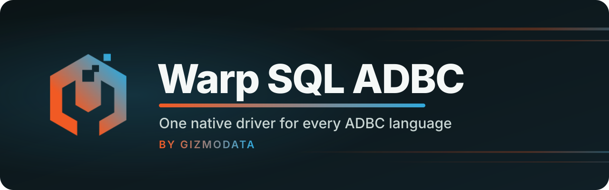

<p align="center">
  <a href="https://github.com/gizmodata/warp-sql">
    
  </a>
</p>

<p align="center">
  <a href="https://arrow.apache.org/adbc/"></a>
  <a href="https://github.com/gizmodata/warp-sql"></a>
  
  
  
  <a href="https://github.com/gizmodata/hardcharger"></a>
  <a href="LICENSE"></a>
  <a href="https://gizmodata.com"></a>
</p>

<h3 align="center">Query any Warp SQL server from Python, Go, R, C/C++, C#, Rust or JavaScript.</h3>

---

## 🔌 What is it?

A native [ADBC](https://arrow.apache.org/adbc/) driver for the
[Warp SQL protocol](https://github.com/gizmodata/warp-sql), written in Go, with Python
bindings.

It is a **generic** driver: it talks to any server that implements the Warp SQL protocol,
version 1 (spec 1.0.0), not one particular database. Compiled to a C shared library, one
implementation serves every ADBC language: Python, Go, R, C/C++, C#, Rust and JavaScript.

- ⚡ **Arrow end to end:** results stream from the server as Arrow IPC straight into
  your `pyarrow.Table`, Go `RecordReader` or any ADBC consumer, with no row conversion.
- 🌐 **Built for real networks:** resumable downloads, safe retries with idempotency keys,
  async submit/poll/fetch for long queries behind proxies, and token renewal.
- 🛑 **Cancel that really cancels:** Ctrl+C or a Go context stops the statement on the server.
- 🔐 **TLS by default**, mutual TLS and token exchange for SSO.

> **Status: 1.0.0, for Warp SQL protocol 1.0.0.** Tested against `warp-duckdb`, the reference
> server, and [Hardcharger](https://github.com/gizmodata/hardcharger) 2.0.0.

## 📥 Install

```bash
pip install adbc-driver-warpsql
```

The wheel carries the driver's shared library for Linux (amd64, arm64; glibc 2.17 or newer),
macOS (arm64, amd64) and Windows (amd64). Go applications `go get
github.com/gizmodata/warp-sql-adbc/go` (the module is versioned by `go/vX.Y.Z` tags, one per
release, on the release's commit). Every other ADBC language loads the library from a
[GitHub Release](https://github.com/gizmodata/warp-sql-adbc/releases) through a driver manifest
(`packaging/warpsql.toml.in`).

## 📂 Layout

```
go/warpsql/          the ADBC driver (driverbase-go), package warpsql
go/internal/protocol the Warp SQL wire client over net/http (no ADBC)
go/pkg/warpsql/      cgo exports for the C shared library (generated)
python/              adbc-driver-warpsql: ships the library in its wheel, adds dbapi.connect()
packaging/           ADBC driver manifest template
docs/                design notes and the test inventory
```

## 🚀 Connecting

| URI | Meaning |
|---|---|
| `warp://host:port` | HTTPS, base path `/warp` (the default) |
| `warp://host:port/custom/prefix` | HTTPS, the server mounts the protocol under `/custom/prefix` |
| `warp://host:port?tls=false` | Plain HTTP (development; loopback) |
| `https://host:port[/prefix]` | Same as `warp://` |
| `http://host:port[/prefix]` | Plain HTTP |

TLS is verified unless `adbc.warp.tls.skip_verify` is set explicitly. Credentials never go
in the URI; a URI with user info is refused. A TLS URI pointed at a plain-HTTP server fails
at once, before anything but the TLS hello is sent, with `The server at HOST:PORT speaks plain
HTTP, not TLS. Add ?tls=false to the URI to connect without encryption.` (for an `https://`
URI: use `http://`); the driver never falls back to plaintext by itself.

Closing a connection ends its server session as a courtesy: when the server has stopped or
doesn't answer, `Close` still succeeds (within 5 seconds) and releases everything the driver
holds, and the session ends on the server when it idles out.

### Go

```go
drv := warpsql.NewDriver(memory.DefaultAllocator)
db, err := drv.NewDatabaseWithContext(ctx, map[string]string{
	"uri":      "warp://db.example.com:31337",
	"username": "joe",
	"password": "…",
})
cnxn, err := db.Open(ctx)
stmt, err := cnxn.NewStatement(ctx)
err = stmt.SetSqlQuery(ctx, "SELECT 42 AS answer")
reader, _, err := stmt.ExecuteQuery(ctx)
```

`warpsql.ErrorCode(err)` returns the server's error code (`sql_error`,
`session_not_found`, …) behind any error the driver returns, or a `client_` code for a
failure the driver found in the server's answer (`client_protocol_error`, and
`client_http_error` for an error status without a problem document, such as a proxy's).
The error details also carry `warp.request_id`, and `warp.reason` / `warp.cancel_reason`
when the server gave one (`token_revoked`, `killed`, …).

Each code has the ADBC status that says what to do about it (`go/warpsql/errors.go`): SQL
that fails, before it runs (`sql_error`) or while it runs (`execution_error`: a division by
zero, a conversion), is `StatusInvalidArgument`, as in the DuckDB and PostgreSQL ADBC
drivers, so Python raises `ProgrammingError`; SQLSTATE `42P01` is `StatusNotFound`, `42P07`
`StatusAlreadyExists` and class `23` (a constraint) `StatusIntegrity` (`IntegrityError`).
Cancels and timeouts are `StatusCancelled` and `StatusTimeout` (`OperationalError`), sign-in
failures `StatusUnauthenticated`, missing privileges `StatusUnauthorized`, limits and a
draining server `StatusIO`. Only a server or driver fault (`internal_error`, an answer that
breaks the protocol) is `StatusInternal` (`InternalError`). A code the driver doesn't know
falls back to its HTTP status. The SQLSTATE, when the server sent one, is in the error's
`SqlState` (Python: `error.sqlstate`).

### Python

```python
from adbc_driver_warpsql import dbapi

with dbapi.connect(uri="warp://db.example.com:31337", username="joe", password="…") as conn:
    with conn.cursor() as cur:
        cur.execute(operation="SELECT * FROM sales WHERE year = ?", parameters=[2026])
        print(cur.fetch_arrow_table())
```

With mutual TLS the certificate can be the credential itself (the server maps it to a
user, on a server that turned certificate sign-in on; Hardcharger's `mtls_certificate_sign_in`
with `mtls_admin_identities` or its access-control users):

```python
dbapi.connect(uri="warp://db.example.com:31337", auth_type="client_certificate",
              tls_client_cert="client.pem", tls_client_key="client-key.pem")
```

On a server with browser sign-in (capability `oauth_browser`, spec §4.3), sign in as
yourself with the server's identity provider; the driver opens your browser and waits:

```python
dbapi.connect(uri="warp://db.example.com:31337", auth_type="oauth_browser")
```

See [python/README.md](python/README.md) for `connect()`'s arguments.

### Any language, through a driver manifest

Build the library (`make -C go lib`), fill in [packaging/warpsql.toml.in](packaging/warpsql.toml.in)
and install it as `warpsql.toml` in an ADBC driver search path; then every driver manager
loads it as `driver = "warpsql"`. Its entry point is `AdbcDriverWarpsqlInit`.

## ⚙️ Options

Database options (with the standard `uri`, `username`, `password` and `adbc.telemetry.*`):

| Option | Default | Meaning |
|---|---|---|
| `adbc.warp.tls.skip_verify` | `false` | Do not verify the server's certificate |
| `adbc.warp.tls.root_certs` | system | PEM CA certificates to trust instead of the system's |
| `adbc.warp.tls.client_cert`, `adbc.warp.tls.client_key` | | PEM client certificate and key (mutual TLS) |
| `adbc.warp.tls.server_name` | URI host | Host name the certificate is checked against |
| `adbc.warp.auth.type` | `password` | `oauth_browser`: browser sign-in (below). `client_certificate` (or `mtls`): sign in with the TLS client certificate alone, no password (spec §4.4; servers with capability `mtls_identity`). Needs the client certificate and key; refuses a username, password or token beside it. The token is bound to the certificate and renewed like a password sign-in's |
| `adbc.warp.oauth.browser` | system browser | With `auth.type` `oauth_browser` (spec §4.3: sign in through a browser with the server's identity provider, when the first connection opens; servers with capability `oauth_browser`): the command that opens the sign-in page (its URL appended), or `none` to print the URL to stderr. The token it yields can't be renewed: once it expires, open a new database |
| `adbc.warp.oauth.timeout_seconds` | `300` | How long the person has to complete a browser sign-in |
| `adbc.warp.auth.access_token` | | An access token issued elsewhere (used as is, never renewed by the driver; may be set again on an open database that signs in with a token or through the browser) |
| `adbc.warp.auth.subject_token` | | An identity provider's token for the `token_exchange` grant |
| `adbc.warp.retry.max_attempts` | `4` | Sends of a request that is safe to repeat, first included |
| `adbc.warp.session.reconnect` | `true` | Replace a session the server lost (see below) |

Statement options; set on the database or connection they are defaults for its statements:

| Option | Default | Meaning |
|---|---|---|
| `adbc.warp.statement.async` | `false` | Submit, poll, then read a retained, resumable result |
| `adbc.warp.statement.retain_result` | server | Ask the server to keep results for re-reading and resuming |
| `adbc.warp.statement.timeout_seconds` | none | The server cancels the statement after this long |
| `adbc.warp.statement.query_tag` | | JSON object recorded with every statement and ingest; sent compact, in ASCII (other characters as `\u` escapes), at most 4,096 bytes so |
| `adbc.warp.ipc_compression` | `auto` | Arrow buffer compression for results and uploads: `lz4_frame`, `zstd`, `none`, or `auto`: `lz4_frame` on a link with a round trip under 10 ms, `zstd` on a slower one (measured when connecting) |
| `adbc.warp.statement.result_partitions` | `32` | Let the server split a large result into up to this many partitions, read at once over separate connections (`1`: one stream) |
| `adbc.warp.statement.result_order` | `preserve` | `any`: a split result's batches come in whatever order they arrive |
| `adbc.warp.ingest.parts` | `auto` | Send a bulk ingest over up to this many connections at once, committed as one (`1`: one ordered stream); `auto`: 16 on a near link, 32 on a far one |

Read-only: `adbc.warp.session.id`, `adbc.warp.session.replacements` and
`adbc.warp.session.transaction` (connection; the server's view, which sees SQL `BEGIN` too:
`none`, `open`, `aborted`, or `unknown`),
`adbc.warp.statement.id` (the statement's last execution). Bulk ingest uses the standard
`adbc.ingest.*` options; the transaction options are the standard ones.

## 🧠 How it behaves

- **Queries** stream on the one-round-trip path by default. Statements without rows (DDL,
  DML) answer with their document, so `ExecuteQuery` returns an empty schema and the rows
  affected. With `async`, the driver submits, long-polls the status, and reads the result
  with `from_batch` resumption: use it for long queries behind proxies with idle timeouts.
- **Split results** (by default; `result_partitions` above 1, on a server with the
  `result_partitions` capability, spec §6.10): the server may split a large result into
  partitions, and the driver downloads every partition at once, each over its own
  connection, into one RecordBatchReader. One TCP connection carries what one network flow
  allows, and decoding then spreads over several cores. With `result_order=preserve` the
  batches come back in the server's order (round robin over the partitions), so `ORDER BY`
  holds; with `any`, as they arrive. Every partition must end with its end-of-stream
  marker: if one fails or is cut off (and can't be resumed), the whole result fails with
  the statement's error. A split result that doesn't say its order (`Warp-Result-Order`, or
  `partition_order`) is refused as a protocol error, never guessed. On a server with the
  `result_locations` capability the driver also reads partitions held by other servers
  (it sends `Warp-Result-Locations: remote` only there, and never sends the access token to
  a location that would drop TLS). `ExecutePartitions` returns the server's partitions. The server
  decides how many by the result's size (Hardcharger: one per two batches for a small
  result, all of them for a large one), and a server without the capability is never
  asked, so small queries cost nothing extra.
- **Compressed results** (`ipc_compression`, spec §8.2): the driver asks for the codec
  on every request that returns Arrow, each partition's included, and decompresses
  record batches itself: every buffer of a batch at once, straight into one new body,
  while the connection keeps reading the next messages. Buffers the server sent as they
  are (length -1) are copied, not decompressed. Message bodies come from a recycler
  over the C library's allocator, so large results don't fault in fresh pages for every
  batch.
- **Partitioned ingest** (by default; `adbc.warp.ingest.parts` above 1, on a server with
  the `partitioned_ingest` capability, spec §8.3): batches over 16,384 rows are sent as
  zero-copy slices of that size (the server's insert threads then share the work
  evenly), and an upload of more than one slice is opened once, sent in parts at once,
  about one per two slices up to `ingest.parts`, each over its own connection and taking
  the next slice from the bound stream, then committed as one. It is all or nothing: if a
  part fails (the bound reader breaks, the server refuses a batch, a connection drops), the
  driver aborts the ingest and nothing is written. The rows land in no defined order; set
  `adbc.warp.ingest.parts=1` to keep the upload's order. A one-slice upload, or a server
  without the capability, gets one stream (§8.1). Each part keeps up to 4 MiB in memory so a
  part whose answer was lost can be sent again with its `Idempotency-Key`.
- **Broken downloads** of a retained result resume from the next batch (up to five times).
  An unretained result cannot be resumed; the error says so and names the options that
  make it resumable. A stream that ends without its end-of-stream marker is never taken
  for a complete result.
- **Retries.** Every submit, prepared execute and ingest carries an `Idempotency-Key`, so
  a request whose answer was lost is sent again without running twice. Reads, deletes and
  idempotent writes are retried after transport errors and 429/502/503/504 (honouring
  `Retry-After`). Commit and rollback are never retried. Uploads up to 16 MiB are kept in
  memory so they can be retried; larger ones stream (chunked) and are sent once.
- **Tokens** are renewed before they expire and, once, when the server refuses one
  (`invalid_token` without a reason, with `token_expired`, or with a reason the driver
  doesn't know). After `token_revoked`, `credentials_changed` or `principal_dropped` the
  driver does not sign in again on its own: the error carries the reason.
- **Lost sessions** (`session_not_found`, or `session_ended` because a token expired, after
  getting a new token) are replaced by a new session with the options the driver set, and the loss is reported,
  not hidden: a warning is logged, `adbc.warp.session.replacements` counts it, and errors
  from work in the replacement say it ran there. Inside a transaction nothing runs on the
  replacement (it would commit half a transaction): the operation fails with the
  transaction named as lost. A prepared statement is prepared again; a retained result is
  gone. With `adbc.warp.session.reconnect=false` the connection stays broken. A session
  ended for any other reason (`killed` by an administrator, credentials changed, …) is an
  error with the reason, and is not replaced.
- **Cancel** (`AdbcStatementCancel`, Python's `adbc_cancel()` and Ctrl+C, closing the
  statement while it runs, or a Go context ending) stops the statement on the server with
  `POST …/cancel`. When its answer has not arrived yet, the driver cancels the session's
  work (`POST /sessions/{id}/cancel`) if it is the connection's only statement running;
  beside other statements, or on a server without the session cancel, it learns the id by
  sending the same request again with its `Idempotency-Key`, which does not run it twice.
- **Done with a result.** Releasing a result, read or not, deletes the statement on the
  server (§6.8): a query still running is cancelled, a write (`INSERT … RETURNING`) runs to
  the end with its rows discarded.
- **Prepared statements** are created on the server only when needed (to bind parameters or
  describe them), which spares a DB-API cursor, which prepares every query, two round
  trips per query. Bound parameters travel as Arrow, one row per execution.
  `ExecuteSchema` returns the schema the server reports when preparing (`result_kind`,
  `result_schema`), without running the statement.
- **Cleanup.** Finished statements are deleted on the server in the background, off the
  caller's path.
- **GetObjects** takes one request per level (catalogs, schemas, tables with their
  schemas) and, at column depth, one each for primary and foreign keys. Errors whose
  SQLSTATE is `42P01`/`42P07` (no such table / it exists) are ADBC NotFound/AlreadyExists.

## 🛠️ Building and testing

Go 1.27, a C toolchain for cgo, and Python 3.11+ for the bindings.

```bash
make -C go lib                      # go/build/libadbc_driver_warpsql.{so,dylib,dll}
make -C go test                     # Go unit tests (no server)

python3 -m venv .venv && . .venv/bin/activate
pip install -e "python[test,dev]"
pytest -m "not integration" python/tests   # Python unit tests (no server)
```

The live-server suites start the server binary named by `WARP_SQL_ADBC_TEST_SERVER_BINARY`
(a `warp-duckdb` build from [warp-sql](https://github.com/gizmodata/warp-sql), or any
server with its command line) on free ports, plain and with TLS:

```bash
export WARP_SQL_ADBC_TEST_SERVER_BINARY=/path/to/warp-duckdb
make -C go integration-test         # Go, with the race detector
pytest python/tests                 # everything, Python
```

Without the variable they fail; they never skip, and a run in which no integration test
ran fails too. See [docs/testing.md](docs/testing.md) for what is tested and what was not
ported from gizmosql-adbc.

## 🚢 Releasing

Pushing a `vX.Y.Z` tag runs [release.yml](.github/workflows/release.yml): every suite on the
tagged commit (ci.yml, plus the Go and Python live suites against `hardcharger-server` from
its container image), then the library for six platforms and a wheel for five (Linux amd64/arm64, macOS
arm64/amd64, Windows amd64; Windows arm64 gets the library only, since pyarrow and
adbc-driver-manager publish no wheels for it). The Linux
wheels are `manylinux` (glibc 2.17 or older) (the library is built with `zig cc` against glibc 2.17, checked
with `scripts/check_glibc.sh`, and installed and loaded on Oracle Linux 8). Then a GitHub
Release with the tag's CHANGELOG section, and PyPI from the `pypi` environment (trusted
publishing, after an approval). Before tagging: set the version in `python/pyproject.toml`
and `python/src/adbc_driver_warpsql/_version.py`, move `[Unreleased]` into a dated section,
regenerate `THIRD_PARTY_NOTICES` if a Go dependency moved (`scripts/third_party_notices.sh`;
CI checks it), and make sure the workflow's `HARDCHARGER_IMAGE` is a build whose server splits
results. The live suites pull `hardcharger-server` from `ghcr.io/gizmodata/hardcharger` with the
workflow's `GITHUB_TOKEN`; while that image is private, the package must grant this repository
read access.

## 📦 Dependencies

- [`apache/arrow-adbc/go/adbc`](https://github.com/apache/arrow-adbc) 1.12 and
  [`apache/arrow-go`](https://github.com/apache/arrow-go) 18.8
- [`adbc-drivers/driverbase-go`](https://github.com/adbc-drivers/driverbase-go) (the
  framework upstream's drivers are built on; it publishes no tagged releases, so it is
  pinned at a commit), which also provides OpenTelemetry tracing and the cgo export template
- Go's `net/http` and `crypto/tls`. The protocol is plain HTTP; gRPC is linked only by
  OpenTelemetry's OTLP trace exporter.

## 📄 License

[Apache License 2.0](LICENSE). The shared library links the Go runtime and the Go modules
listed, with their licenses, in
[THIRD_PARTY_NOTICES](python/src/adbc_driver_warpsql/THIRD_PARTY_NOTICES), which ships in
every wheel and library tarball.

---

<p align="center">
  <a href="https://gizmodata.com"></a><br>
  <sub>Built by <a href="https://gizmodata.com">GizmoData</a></sub>
</p>

---

<p align="center"><sub>Hardcharger™ and GizmoData™ are trademarks of GizmoData LLC.</sub></p>
