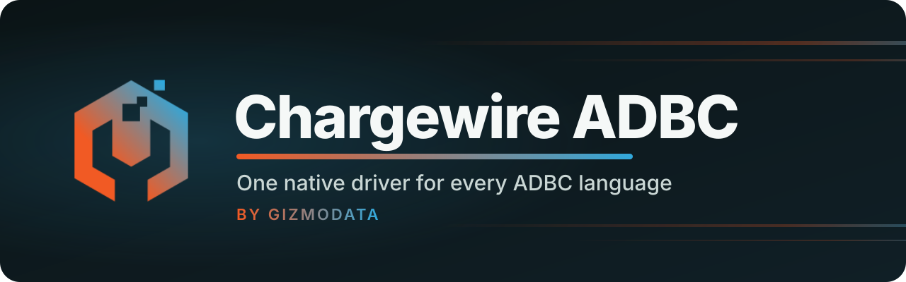

<p align="center">
  <a href="https://github.com/gizmodata/chargewire">
    
  </a>
</p>

<p align="center">
  <a href="https://github.com/gizmodata/chargewire-adbc/actions/workflows/ci.yml"></a>
  <a href="https://pypi.org/project/adbc-driver-chargewire/"></a>
  <a href="https://pypi.org/project/adbc-driver-chargewire/"></a>
  <a href="https://pypi.org/project/adbc-driver-chargewire/"></a>
  <a href="https://arrow.apache.org/adbc/"></a>
  <a href="https://github.com/gizmodata/chargewire-adbc/blob/main/validation/README.md"></a>
  <a href="https://adbc-drivers.org/building-drivers/style-guide.html"></a>
  <a href="https://github.com/gizmodata/chargewire"></a>
  
  
  
  <a href="https://github.com/gizmodata/hardcharger"></a>
  <a href="https://github.com/gizmodata/chargewire-adbc/blob/main/LICENSE"></a>
  <a href="https://gizmodata.com"></a>
</p>

<h3 align="center">Query any Chargewire server from Python, with Arrow results.</h3>

---

## 🔌 What is it?

A Python [ADBC](https://arrow.apache.org/adbc/) driver for the
[Chargewire protocol](https://github.com/gizmodata/chargewire): SQL over plain HTTP, with
results, parameters and bulk uploads as Arrow IPC streams. It is generic: it talks to any
Chargewire server.

The driver itself is a native Go library (`libadbc_driver_chargewire`) bundled in the
platform wheel; this package adds a DB-API 2.0 `connect()`.

It needs Python 3.10 or newer, with pyarrow 16.0.0+ and adbc-driver-manager 1.8.0+, which pip
installs with it.

## 🚀 Usage

```python
from adbc_driver_chargewire import dbapi

with dbapi.connect(
    uri="chargewire://db.example.com:31337",  # HTTPS; add ?tls=false for plain HTTP
    username="joe",
    password="…",
) as conn:
    with conn.cursor() as cur:
        cur.execute(operation="SELECT n_name FROM nation WHERE n_nationkey = ?", parameters=[24])
        print(cur.fetch_arrow_table())

        cur.execute(operation="CREATE TABLE t (id INTEGER)")  # runs right away
        cur.adbc_ingest(table_name="t", data=my_arrow_table, mode="append")
```

`connect()` takes:

| Argument | Meaning |
|---|---|
| `uri` | `chargewire://host:port[/base-path]` (TLS), `?tls=false` for plain HTTP; `https://` and `http://` URLs work too. `profile://name` names a connection profile. |
| `username`, `password` | Password sign-in (any characters, `:` included). |
| `access_token` | A Chargewire access token obtained elsewhere, instead of a password. |
| `auth_type` | `"password"` (default), `"client_certificate"` (`"mtls"`): sign in with `tls_client_cert`/`tls_client_key` alone, no password (the server binds the token to the certificate), or `"oauth_browser"`: sign in through a browser with the server's identity provider (servers with capability `oauth_browser`). |
| `open_browser` | Browser sign-in: `True` (default) opens the system's browser, `False` prints the sign-in URL to stderr, a string is the command that opens it. |
| `oauth_timeout_seconds` | Browser sign-in: how long the person has to sign in (default 300). |
| `resume_timeout` | Seconds to keep sending a request again while the server answers `server_resuming` (a stopped server starting again because you connected), each time after its `Retry-After` (default 600; `0`: fail at once). |
| `tls_root_certs` | CA certificates to trust (PEM text or file path). |
| `tls_client_cert`, `tls_client_key` | Client certificate for mutual TLS (PEM text or path). |
| `tls_skip_verify` | Skip certificate verification (development only; off unless set). |
| `catalog`, `db_schema` | Make these current for the session. `db_schema` is one schema name in `catalog` (in the server's default catalog without it) and is never split at a dot: for the schema `reports` of the catalog `lake`, pass `catalog="lake", db_schema="reports"`. |
| `autocommit` | `True` by default; `False` starts a transaction (`conn.commit()`, `conn.rollback()`). |
| `profile` | An ADBC connection profile (needs adbc-driver-manager 1.11.0 or newer, which resolves it). |
| `db_kwargs`, `conn_kwargs` | Any other driver option, e.g. `chargewire.query.async`. |

Driver options are in `adbc_driver_chargewire.DatabaseOptions`, `ConnectionOptions` and
`StatementOptions`; the repository README lists them all.

By default, on a server that offers it, a large result is read over up to 8 connections at
once (`StatementOptions.RESULT_PARTITIONS`), and an `adbc_ingest` of two batches or more is
sent as up to 8 parts at once and committed as one, all or nothing
(`StatementOptions.INGEST_PARTS`). Set either to `"1"` for one stream; a partitioned ingest's
rows land in no defined order.

Errors are `adbc_driver_manager` exceptions whose `details` carry the server's error code
(`b"chargewire.code"`, e.g. `b"sql_error"`) and request id (`b"chargewire.request_id"`).

## 🔒 Read-only sessions

Request server-enforced read-only mode when opening the connection:

```python
from adbc_driver_chargewire import dbapi

with dbapi.connect(
    uri=uri,
    username=username,
    password=password,
    conn_kwargs={"adbc.connection.readonly": "true"},
) as conn:
    with conn.cursor() as cur:
        cur.execute(operation="SELECT 42 AS answer")
        print(cur.fetchone())  # (42,)
```

Here `uri`, `username`, and `password` are your server connection details. The option
is sent in the session-creation request, before session setup. The driver requires
`options.read_only: true` in the server's response. An older server that rejects or
ignores the option causes an error; the driver never falls back to writable mode.
Connections that omit the option continue to work with older servers.

A lazy connection to a stopped server confirms the mode at its first operation;
reading the option also opens and confirms it. Read-only is one-way, even before a
lazy session opens, and is requested and confirmed again on replacement sessions.
Open a separate connection to write. Setting the option to `"true"` on an existing
connection requests the same restriction; the server may refuse until you end an
active transaction. Attaching with the option restricts that shared session too.

Read-only limits SQL writes as defined by the server's Chargewire implementation.
It does not grant additional read permissions or sandbox installed extension code.

## 🛠️ Development

See the [repository](https://github.com/gizmodata/chargewire-adbc): build the library with
`make -C go lib`, then `pip install -e "python[test]"`. Unit tests need no server; the
integration tests start the server named by `CHARGEWIRE_ADBC_TEST_SERVER_BINARY` and fail
without it.

---

<p align="center">
  <a href="https://gizmodata.com"></a><br>
  <sub>Built by <a href="https://gizmodata.com">GizmoData</a></sub>
</p>

<p align="center"><sub>Hardcharger™ and GizmoData™ are trademarks of GizmoData LLC.</sub></p>
